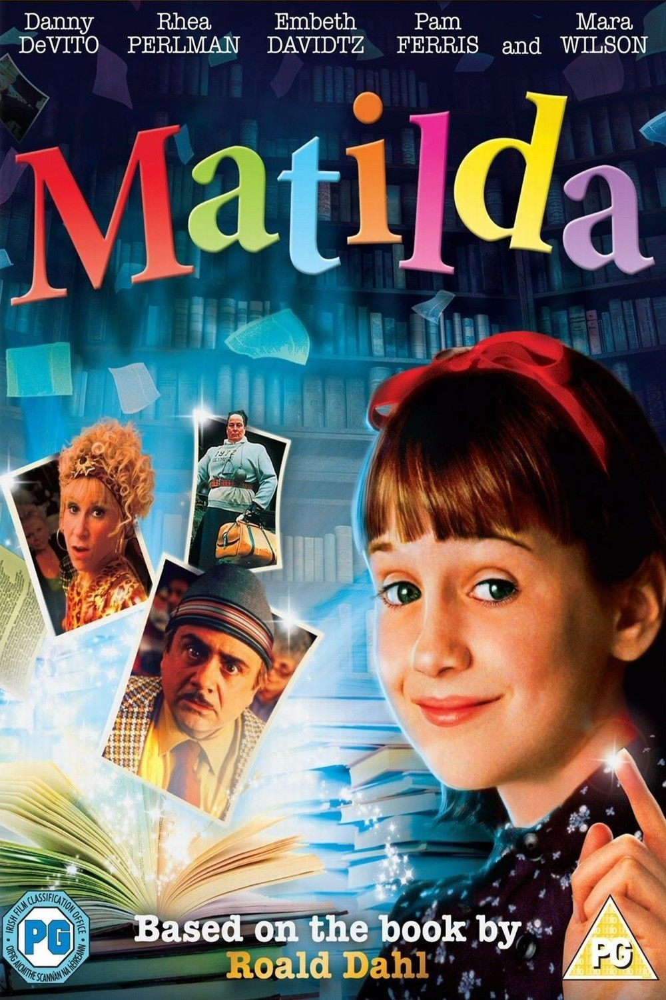
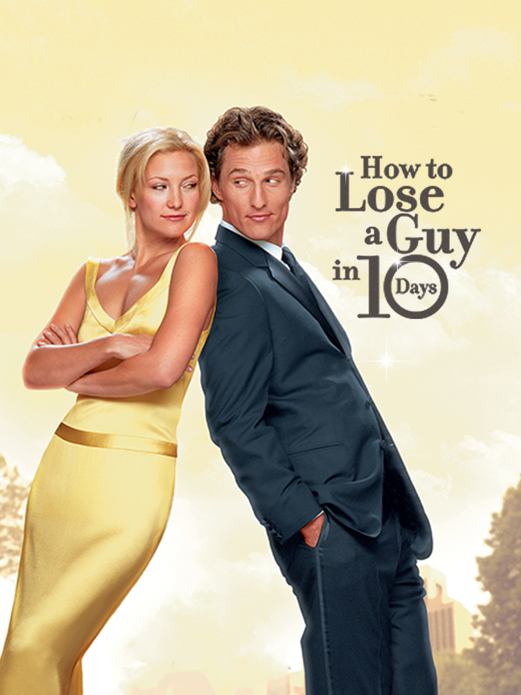
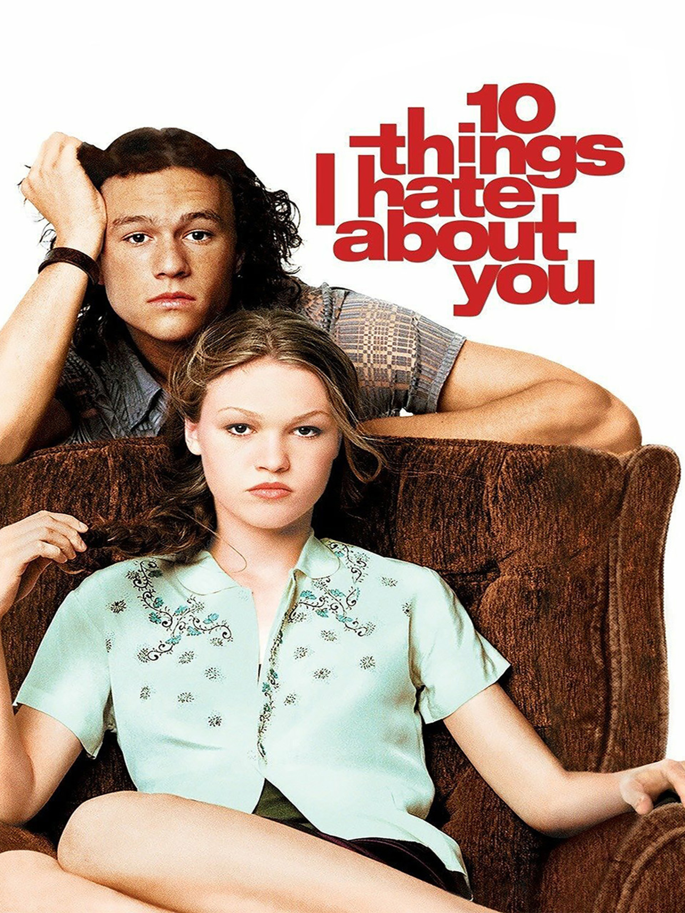
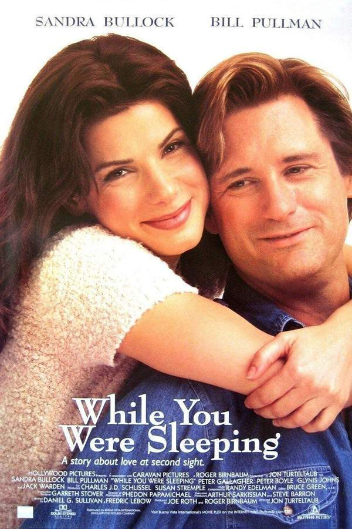
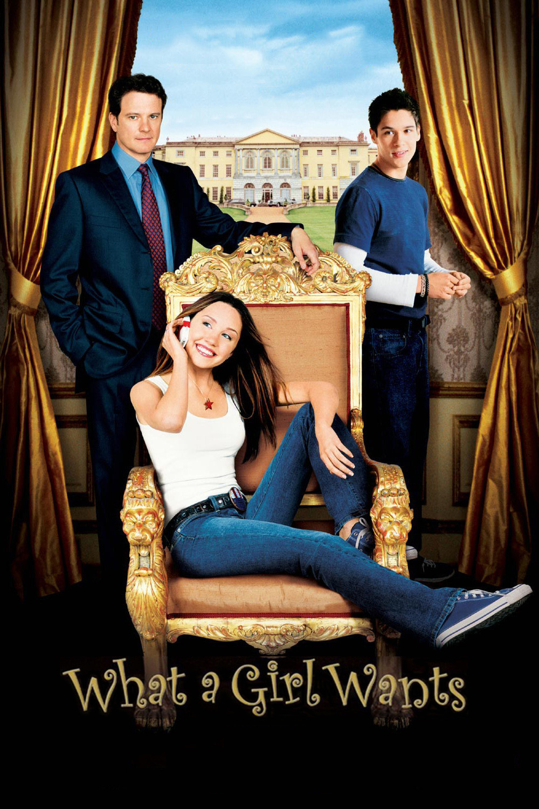

# My Favorite Movies
1. **Matilda** (*1996 film*) An American fantasy comedy film based on Roald Dahl's 1998 novel *Matilda*.

---
2. **How to Lose a Guy in 10 Days** (*2003 film*) A romantic comedy film in which Andie Anderson deliberately drives a man away in ten days for an article, while Benjamin Barry simultaneously tries to make her fall in love as part of a bet.

---
3. **10 Things I Hate About You** (*1999 film*) An American teen romantic comedy directed by Gil Junger, starring Julia Stiles, Heath Ledger, and Joseph Gordon-Levitt. inspired by Shakespeare's *The Taming of the Shrew*.

---
4. **While You Were Sleeping** (*1995 film*) An American romantic comedy film directed by Jon Turteltaub and written by Daniel G. Sullivan and Fredric Lebow.

---
5. **What A Girl Wants** (*2003 film*) An American teen comedy film starring Amanda Bynes as Daphne Reynolds, a 17-year-old who travels to London to meet her estranged father, played by Colin Firth.

